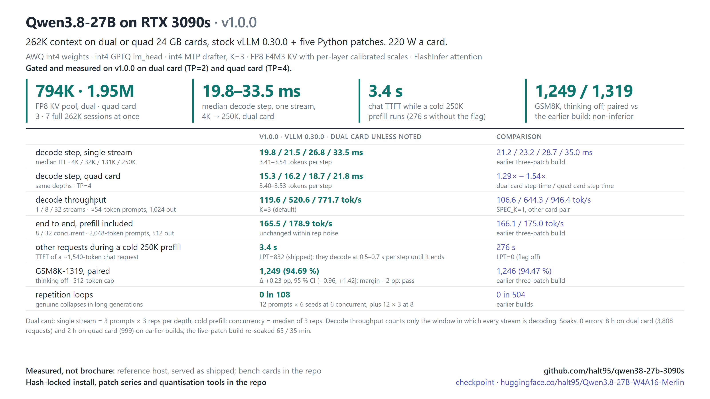
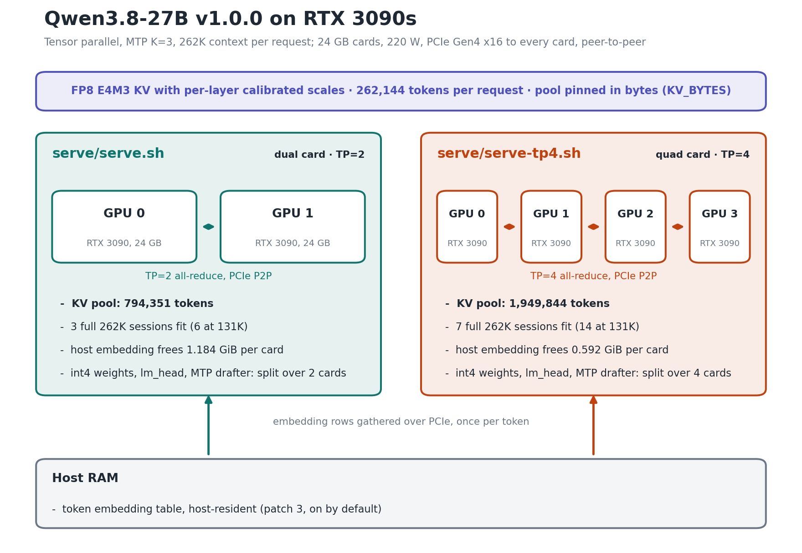
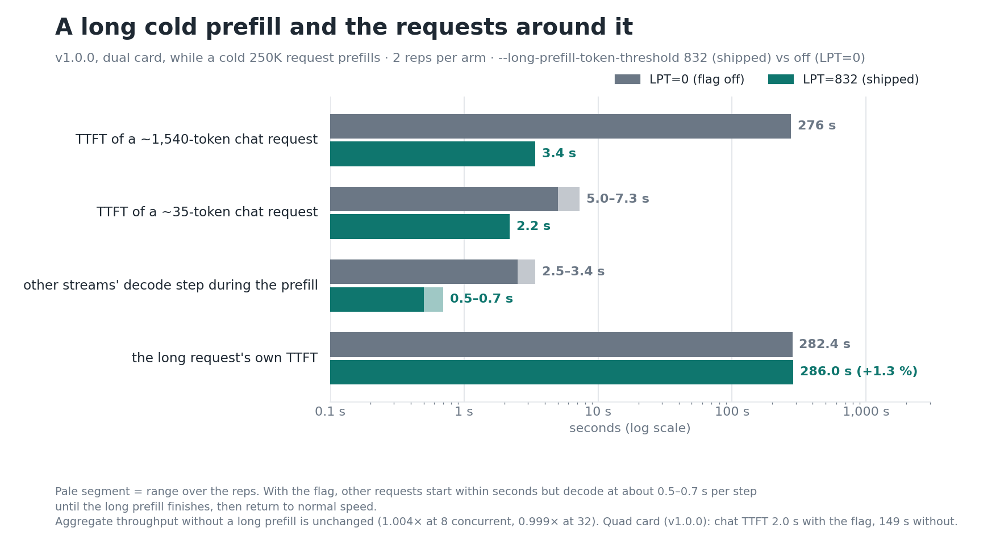

# Release history

Earlier release material, moved here from the [README](../README.md). The current release is v1.3.1 (documentation fixes on v1.3.0); its notes are in
[CHANGELOG.md](../CHANGELOG.md#v130) and its numbers in [reference.md](reference.md#benchmarks).

## The releases in brief (v1.3.0, v1.1.0, v1.0.0)

**v1.3.0** (2026-10-12) moves to Merlin engine v2.5.2 with the 27B patch series (0001-0011), adds the FlashInfer 32-row
verify tile, makes MTP K=4 the default and adds the ThinkingCap checkpoint profile. Dual and quad card only. See
[v1.3.0](../CHANGELOG.md#v130).

**v1.1.0**, a single card profile, was gated but not published; the single card profile returns in a later release.

**v1.0.0** (2026-09-27) was the first public release: stock vLLM 0.30.0 from PyPI plus patches 0001-0005
(`patches/vllm-0.30.0/`, kept in this repository for reference; v1.3.0 does not use it), the dual card
(`serve/serve.sh`, TP=2, KV pool 794,351 tokens) and quad card (`serve/serve-tp4.sh`, TP=4, KV pool 1,949,844 tokens)
profiles at 262K with MTP K=3, and a container recipe. On v1.0.0 prefix-cache reuse covered prompt prefixes, not a
previous turn's generated tokens, so a follow-up re-prefilled the previous answer. See [v1.0.0](../CHANGELOG.md#v100).
The `v1.0.0` tag keeps the container recipe, for the old engine.

## v1.0.0 on stock vLLM 0.30.0 (K=3)

For comparison only: different engine, different harness, no tile. Single stream, median decode step and decode rate,
dual card (`serve/serve.sh` of v1.0.0) and quad card:

| Prompt depth | Dual card ITL | Dual card decode | Quad card ITL | Quad card decode |
|---|---:|---:|---:|---:|
| 4K | 19.8 ms | 171.4 tok/s | 15.3 ms | 231.2 tok/s |
| 32K | 21.5 ms | 159.3 tok/s | 16.2 ms | 210.8 tok/s |
| 131K | 26.8 ms | 132.3 tok/s | 18.7 ms | 190.8 tok/s |
| 250K | 33.5 ms | 108.3 tok/s | 21.8 ms | 165.5 tok/s |

Decode rate = completion tokens ÷ decode time for the one stream, median over 9 requests, every request a cold prefill
(card: [`benchmarks/2026-09-26/BENCH-CARD.md`](../benchmarks/2026-09-26/BENCH-CARD.md)). Decode throughput at 32 concurrent
streams was 771.7 tok/s (K=3) and 946.4 (K=1) on dual card, 1,120.9 (K=3) and 948.1 (K=1) on quad card; with a cold 250K
prompt prefilling, a chat request started in 3.4 s on dual card (276 s without the long-prefill threshold) and 2.0 s on
quad card (149 s). These concurrency and long-prefill figures are v1.0.0 history: the v1.3.0 gate did not re-run the
c1-c32 decode ladder or the long-prefill probe. K=1 was measured on v1.0.0 only; it is not re-measured on the v1.3.0
engine. The earlier three-patch build that v1.0.0 was compared against has its own card:
[`benchmarks/2026-09-25/BENCH-CARD.md`](../benchmarks/2026-09-25/BENCH-CARD.md).

## v1.0.0 quality

- **Paired GSM8K-1319** (previous engine): dual card against the earlier three-patch build, and quad card against dual
  card, both passed a non-inferiority margin fixed before the run (figures in the
  [v1.0.0 README](https://github.com/halt95/qwen38-27b-3090s/blob/v1.0.0/README.md)).
- **Repetition loops:** v1.0.0 saw 0 genuine collapses in 108 generations and 0 in 504 on earlier builds (counts and
  protocol: [`loop-check.md`](loop-check.md)).
