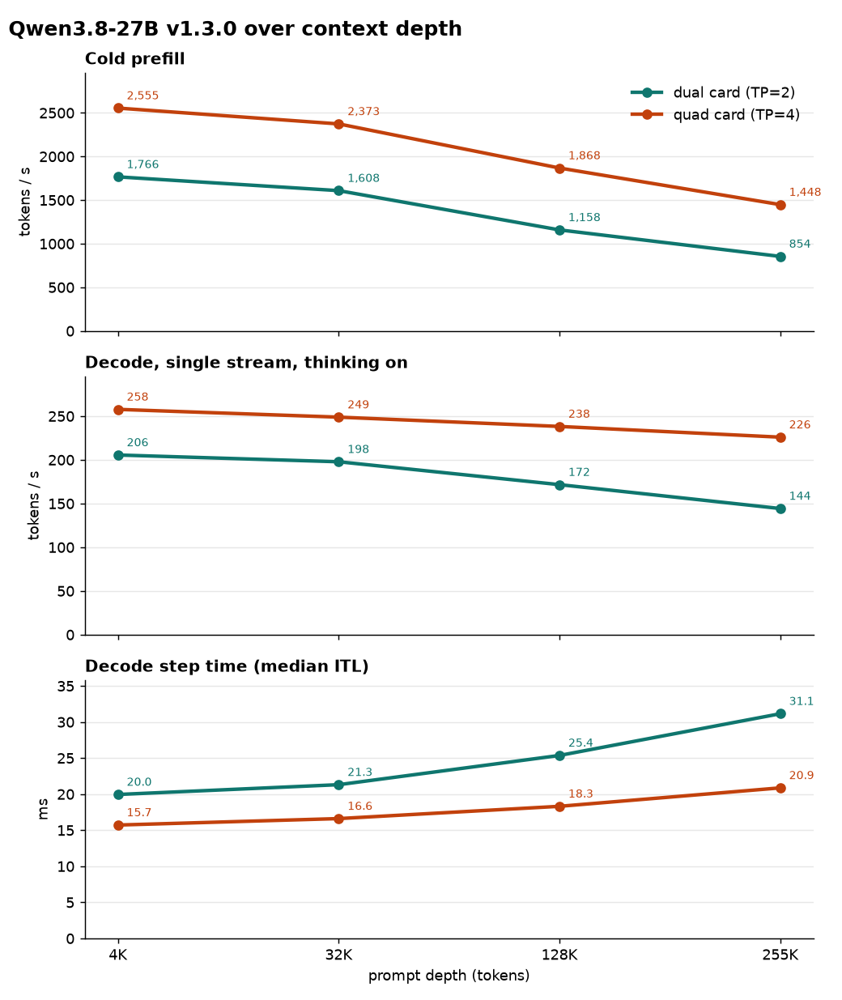
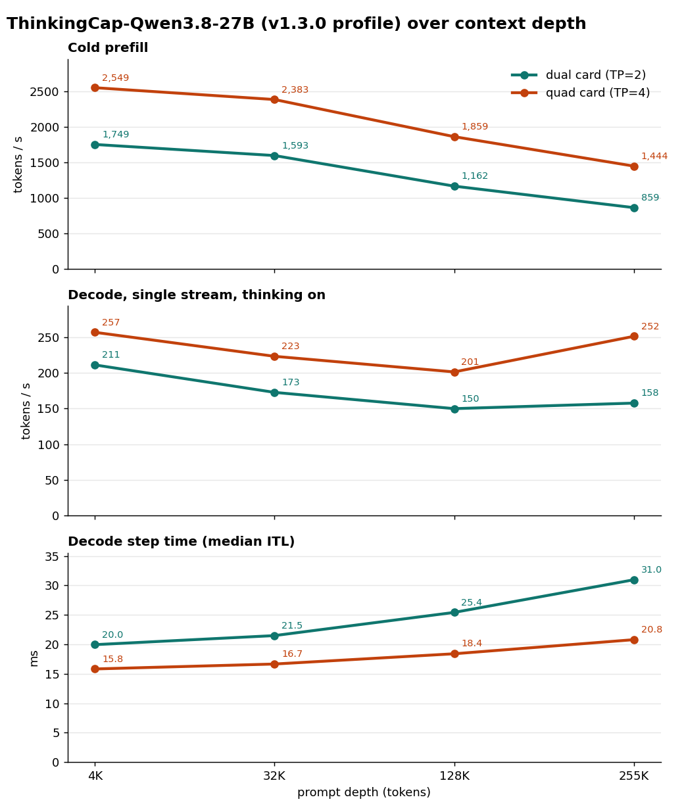

# Reference

The detail behind the [README](../README.md): the checkpoints and the engine, what the install and serve scripts do,
serve-script variables and knobs, requirements, the ThinkingCap checkpoint profile, health checks and troubleshooting,
what is in v1.3.0, how the model sits on the cards, capacity, benchmarks and known behaviours. Release notes are in
[CHANGELOG.md](../CHANGELOG.md); v1.0.0 and its numbers in [history.md](history.md).

- [Overview](#overview)
- [Build and serve](#build-and-serve): [Which profile](#which-profile), [Knobs](#knobs), [Requirements](#requirements)
- [ThinkingCap checkpoint profile](#thinkingcap-checkpoint-profile)
- [Check it's working](#check-its-working), [Troubleshooting](#troubleshooting), [Running notes](#running-notes)
- [What is in v1.3.0](#what-is-in-v130)
- [How it works](#how-it-works): [Hardware](#hardware), [The KV budget](#the-kv-budget),
  [Host-resident embeddings](#host-resident-embeddings-our-design), [Stack](#stack), [Checkpoint](#checkpoint),
  [Serving an agent](#serving-an-agent)
- [Benchmarks](#benchmarks): [v1.3.0 numbers](#v130-numbers), [SPEC_K](#spec_k), [Quality](#quality)
- [Known behaviours](#known-behaviours)
- [What ships next](#what-ships-next), [Glossary](#glossary), [Credit](#credit)

## Overview

Qwen3.8-27B (a 27B hybrid of Gated DeltaNet linear attention and full attention, with a vision tower and a one-layer
MTP head) served with vLLM at its **full 262,144-token context** on consumer Ampere cards: int4 weights, int4 `lm_head`
and drafter, FP8 E4M3 KV, MTP with **K=4** draft tokens per step, fp16 SSM state.

- **Dual card (2× RTX 3090, TP=2), RecoverSSM on:** an 826,689-token FP8 KV pool (883 blocks of 960 tokens, 3.15× 262,144):
  **three 262K sessions or six 131K sessions resident, 0 preemptions** (release gate, 2026-10-08 to 2026-10-09 (UTC)).
- **Quad card (4× RTX 3090, TP=4):** a 1,974,072-token FP8 KV pool (2,470 blocks of 848 tokens, 7.53× 262,144): **seven
  262K sessions resident, 0 preemptions**, prefix-cache hit 88.6 % on the 8-conversation load (release gate,
  2026-10-08 to 2026-10-09 (UTC)).
- **Single-stream thinking decode** ([numbers](#v130-numbers)): dual card 206 / 198 / 172 / 144 tok/s at 4K / 32K / 128K /
  255K, quad card 258 / 249 / 238 / 226 (release gate, 2026-10-08 to 2026-10-09 (UTC); thinking on, effort low, 256-token
  generations; rounded to whole tok/s from the bench card's one-decimal figures). Terms such as MTP, TP, P2P and ITL are explained in the [Glossary](#glossary).

**v1.3.0 changes the engine.** It runs on **Merlin engine v2.5.2** (vLLM 0.30.0 plus the Flash-Next fork
commits and the guard fix) with the **27B patch series** `patches/merlin-engine-v2.5.2/` (0001-0011), a **FlashInfer 32-row verify tile** for
the MTP verify step, and **MTP K=4** as the default. The dual and quad card profiles are `serve/serve.sh` and
`serve/serve-tp4.sh`. The single card profile is parked and returns in a later release.
Bare metal only in this release; the container route returns in a later release. Validated on sm_86 (Ampere) only.

**Second checkpoint profile: [ThinkingCap](#thinkingcap-checkpoint-profile).** BottleCap AI's reasoning fine-tune of
Qwen3.8-27B, in the same 4-bit format, served on this same engine at `xhigh` effort by default
(`serve/serve-thinkingcap.sh`, `serve/serve-thinkingcap-tp4.sh`). Its weights carry their own licence.

The 27B series is active only for a dense "Qwen3.5" target on sm_86; every other model takes the stock path.
"Qwen3.5" here is the name of the architecture class vLLM loads (`Qwen3_5ForCausalLM` /
`Qwen3_5ForConditionalGeneration`), which Qwen3.8-27B uses; it is not a different model, and the patches apply to this
checkpoint.

## Build and serve

| path | what |
|---|---|
| `release/install-env.sh` | creates the venv, installs every dependency from hash-locked files, applies the engine, `patches/merlin-engine-v2.5.2/` and the FlashInfer tile patch with every exit code checked, asserts each marker and runs `pip check`; refuses to overwrite an existing venv. It first checks the engine bundle and the compiled-artifact tarball against `upstream/PIN` (sha256) and the engine's commit and tree |
| `release/requirements-*.txt`, `hash_lock.py` | the hash-locked environment (transformers 5.18.0, flashinfer-python, torch from PyPI = the CUDA 13.0 build) and the script that rebuilds the lock. `requirements-pip.txt` pins pip 26.2.1 and `requirements-build-tools.txt` the build tools of the editable engine install |
| `release/apply-flashinfer-patch.sh`, `check-tile-proof.sh` | apply and verify the FlashInfer 32-row verify tile patch (whole-file sha256 of the five touched files, pristine and patched); check the tile's proof line in a server log |
| `release/checkpoint.sha256` | checksums of the 11 checkpoint files; the `tokenizer.json` line is the upstream Qwen3.8-27B file (sha256 `0997f410…`), which the v1.3.0 checkpoint publication swaps in. Checked inside the download directory |
| `release/checkpoint-thinkingcap.sha256` | checksums of the 11 files of the [ThinkingCap](#thinkingcap-checkpoint-profile) checkpoint (`tokenizer.json` is the upstream file). Checked inside its download directory |
| `release/SHA256SUMS`, `PACKAGE-MANIFEST.md`, `make_manifest.py` | checksums, mode and size of every other file, and the script that writes them |
| `patches/merlin-engine-v2.5.2/` | the 27B series 0001-0011 against Merlin engine v2.5.2, with per-patch notes in its [README](../patches/merlin-engine-v2.5.2/README.md). `patches/vllm-0.30.0/` is the v1.0.0 series for stock vLLM 0.30.0, kept for reference; v1.3.0 does not use it |
| `serve/serve.sh`, `serve/serve-tp4.sh` | the served entries (dual card, quad card), with every host-specific piece lifted into a variable; `serve/templates/` holds the vendored chat template |
| `serve/serve-thinkingcap.sh`, `serve/serve-thinkingcap-tp4.sh` | the [ThinkingCap](#thinkingcap-checkpoint-profile) entries: `THINKING` defaults to `xhigh` effort, then `serve.sh` / `serve-tp4.sh` run with every other variable passed through |
| `licenses/` | copies of the ThinkingCap weights' licence files (BottleCap AI's `LICENSE` and `NOTICE`, the PolyForm Small Business 1.0.0 text, Qwen's Apache-2.0 text); they cover those weights, not this repository's code |
| `quant/` | the tools that made the checkpoint's additions: KV-scale calibration, head and drafter calibration and GPTQ int4 of `lm_head` and the drafter, an artefact identity check, and the calibrated KV scales as written |
| `benchmarks/<date>/BENCH-CARD.md` | the bench cards: `2026-10-12` is v1.3.0 on dual and quad card, with `ThinkingCap-BENCH-CARD.md` beside it for the ThinkingCap checkpoint, `2026-09-26` v1.0.0, `2026-09-25` the earlier three-patch build. |
| `docs/` | the repetition-loop check (`loop-check.md`) and the release graphics |

The patches are pure Python apart from the FlashInfer tile, which JIT-compiles with `nvcc` on the first boot like the
rest of FlashInfer's kernels. The first boot of a new install takes several minutes; later boots reuse the cache.

**Serve-script variables:** `MODEL` is required; the rest are optional: `PORT` (8100), `HOST` (127.0.0.1), `SERVED`
(`qwen38-27b`), `VENV` (`<repo>/.venv`), `GPUS` (`0,1`; `0,1,2,3` for quad card, PCI bus order), `KV_BYTES` (the per-card
pool pin; `auto` drops it), `LPT` (832; `0` removes the flag), `SPEC_K` (**4**; 3 or 1), `CHAT_TEMPLATE` (empty = the
checkpoint's own), `THINKING` (default chat-template kwargs: thinking on, medium effort; `xhigh` in the ThinkingCap wrappers), `MAX_PIXELS` (4194304, the
per-image pixel cap; see [Knobs](#knobs)), `CUDA_HOME` (`/usr/local/cuda`, for FlashInfer's JIT) and
`FLASHINFER_SM8X_FP8_SMALLQ` (see [Knobs](#knobs)). The patch switches are
environment variables of their own ([What is in v1.3.0](#what-is-in-v130)).

`HOST=0.0.0.0` exposes an endpoint without an API key on every interface: if the host is reachable from other machines,
set `VLLM_API_KEY` in the environment (clients then send `Authorization: Bearer <key>`), or keep the default
`127.0.0.1` behind a proxy.

**Telemetry.** Both serve scripts disable vLLM's usage statistics by default (`VLLM_NO_USAGE_STATS=1`,
`DO_NOT_TRACK=1`); set both to `0` to opt in. The download step sets `HF_HUB_DISABLE_TELEMETRY=1` for the same reason.

### Which profile

| Profile | Cards | Context | Status |
|---|---:|---:|---|
| `serve/serve.sh` | dual card (2, TP=2) | 262K | Headline profile; gated on v1.3.0; RecoverSSM on, `--max-num-seqs 16 --max-num-batched-tokens 2048`, 3 × 262K or 6 × 131K resident; needs P2P |
| `serve/serve-tp4.sh` | quad card (4, TP=4) | 262K | Gated on v1.3.0; no RecoverSSM, `--max-num-seqs 24 --max-num-batched-tokens 2048`, 7 × 262K resident; needs P2P |
| single card | 1 | | Parked; returns in a later release |

### Knobs

| knob | default | what it does |
|---|---|---|
| `SPEC_K` | **4** | MTP draft tokens per step; 3 and 1 are accepted (the measured values), anything else is refused. Capture sizes follow K |
| `FLASHINFER_SM8X_FP8_SMALLQ` | `cta32` | FlashInfer 32-row verify tile for the MTP verify attention (q_len 4 or 5, i.e. K=3 or 4, fp8 KV, sm_86; other shapes and architectures take the stock path). Set it to the empty string (`FLASHINFER_SM8X_FP8_SMALLQ= serve/serve.sh`; an unset variable gets the default back) to run stock FlashInfer; `0` also turns it off. Only `cta32`, `0` and the empty string are accepted; any other value (for example the benchmark arm `cta16`) is refused with exit 2. Needs the patched FlashInfer |
| `MAX_PIXELS` | **4194304** | Per-image pixel cap (2048×2048); larger images are downscaled to fit before the vision encoder. At the release gate, on the shipped default, a 16 MP image was downscaled to the cap and answered (HTTP 200, 4,123 prompt tokens, 3.7 s dual card, 2.8 s quad card) and 8 distinct 4 MP images in one prompt answered (HTTP 200, 32,809 prompt tokens, 28.6 s and 19.9 s); the uncapped case was not re-run. Empty = no cap (not recommended). Anything but a plain decimal between 65536 and 33554432 without a leading zero is refused with exit 2. |
| `--prefix-match-unit` | 16 (fixed in the scripts) | prefix-cache match granularity; must divide the hybrid KV block (832 at K≤3, 848 at K=4, 960 on dual card with RecoverSSM at K=4) |
| `LPT` | 832 | `--long-prefill-token-threshold`; `0` removes it |
| `VLLM_HOST_EMBED_TABLE` | unset = on for the dense Qwen3.5 family | host-resident embedding table; `0` off, `1` explicit |
| `VLLM_FLASHINFER_PLAN_CACHE` | on | FlashInfer decode-plan cache (used only when the resolved backend is `fa2`); `0` off |
| `VLLM_GDN_BA_SPLITK` | on | split-K GEMM for the GDN `in_proj_ba`; `0` off |
| `VLLM_DRAFT_SEQ_LENS_NOSYNC` | on | no device sync for the second MTP draft step; `0` off |
| `VLLM_E2_GUARD_IDLE` | on (set explicitly by both serve scripts) | the bounds-guard reader parks with no device work while the server is idle (the engine's guard fix); `0` polls every 50 ms, idle or not |
| `KV_BYTES` | per-card pin: **14,756,413,440** (dual card, 883 blocks), **18,231,050,240** (quad card, 2,470 blocks) | whole KV pool blocks at K=4 ([The KV budget](#the-kv-budget)); `auto` drops the pin (unqualified) |

### Requirements

| | Required | Reference host |
|---|---|---|
| GPUs | 2× (dual card) or 4× (quad card) 24 GB sm_86 cards, with no other process on them | RTX 3090 |
| OS | Linux x86_64 with glibc ≥ 2.34 (the compiled engine libraries need it) | Debian 13, glibc 2.41 |
| NVIDIA driver | one that supports CUDA 13.0 | 610.43.02, P2P-enabled |
| CUDA toolkit | `nvcc` at `/usr/local/cuda` or `$CUDA_HOME`, for FlashInfer's JIT (the tile included) | 13.3 |
| Python | 3.13, with `venv` | 3.13 |
| Tools | git, `sha256sum`, GNU `patch`, `flock` (util-linux) | |
| Disk | about 17 GB (15.9 GiB) for the checkpoint, plus the venv and the engine source tree (`.vllm-v2.5.2`) | |
| System RAM | **about 2.4 GiB more than a standard vLLM serve**: the token-embedding table lives in pinned host RAM, 1.18 GiB per GPU on dual card or 0.59 on quad card | 192 GB host (152 GiB to the serving environment) |
| Interconnect | GPU peer-to-peer (P2P): the serve scripts skip vLLM's P2P check and set `NCCL_P2P_LEVEL=SYS`. Without P2P remove those two settings (unmeasured). PCIe Gen4 x16 and P2P were used for every measurement | P2P-enabled driver |

Not yet run outside the reference host: no other GPU, distribution, driver or non-P2P host.

## ThinkingCap checkpoint profile

BottleCap AI's [ThinkingCap-Qwen3.8-27B](https://huggingface.co/bottlecapai/ThinkingCap-Qwen3.8-27B) is a reasoning
fine-tune of Qwen3.8-27B that reasons in fewer tokens.
[halt95/ThinkingCap-Qwen3.8-27B-W4A16-Merlin](https://huggingface.co/halt95/ThinkingCap-Qwen3.8-27B-W4A16-Merlin) is our
W4A16 quantisation of it (made from BottleCap's revision `7891e03`) in the same 4-bit format as this release's checkpoint: an AWQ int4 body made with
philbert's recipe unchanged, plus this release's calibrated FP8 E4M3 KV scales, int4 `lm_head` and int4 MTP drafter, reused byte
for byte (ThinkingCap's `lm_head`, embeddings and MTP head are bit-identical to the base's, and its KV activation maxima fit
inside the base's scales and their 1.10 calibration margin). `tokenizer.json` is the upstream file; 11
files, about 17 GB. It runs on this repository's engine, patch series and serve scripts unchanged; the only serving
difference is the default reasoning effort, **`xhigh`** (the base profile serves `medium`). This is an independent quantised
derivative: it is **not** published, reviewed or endorsed by BottleCap AI or Qwen.

To download, check and serve it: [Quick start](../README.md#quick-start), steps 3 and 4 (after steps 1 and 2, which are
the same for both checkpoints).

The two wrappers set `THINKING` to `{"enable_thinking": true, "reasoning_effort": "xhigh"}` unless you set it yourself, then
run `serve/serve.sh` / `serve/serve-tp4.sh` with every other variable passed through (same pins, knobs, port and served name
`qwen38-27b`). A request can still choose its own effort (`"chat_template_kwargs": {"reasoning_effort": "medium"}`), and
`THINKING='{"enable_thinking": true, "reasoning_effort": "medium"}'` serves the base profile's default.

**Licence of the weights.** PolyForm Small Business License 1.0.0 plus BottleCap AI's personal, non-commercial
permission; there is no unrestricted commercial use. The full summary is in the README's [License](../README.md#license)
section; copies of the licence files are in [`licenses/`](../licenses/), and the changes made to the checkpoint are listed
in [NOTICE](../NOTICE).

**Measured on this checkpoint** (dual card unless marked; full rows in the
[ThinkingCap bench card](../benchmarks/2026-10-12/ThinkingCap-BENCH-CARD.md)):

- **Thinking length** (GSM8K, the same items for both arms, per-item seeds, paired against this release's checkpoint): at
  medium effort (1,319 items) x0.860 of the base's median thinking tokens (paired medians 157 to 135, 95 % CI 0.840-0.879; means 205.9 to 170.2) at 97.27 %
  accuracy for both (non-inferior within 2 pp, p = 0.001); at `xhigh` (400 items) x0.579 (medians 140 to 81, 95 % CI 0.533-0.625; means 458.4 to 176.4) at
  97.75 % against 96.75 % (a report-only cell). No answer in this paired run was cut at the token cap. One task family (arithmetic word problems);
  the saving on code, long-context or agentic work was not measured.
- **Decode, dual card:** the median decode step equals the base checkpoint's within 1 % at 4K to 255K (20.0 / 21.5 / 25.4 /
  31.0 ms against 20.0 / 21.3 / 25.4 / 31.1 ms, 2026-10-08 gate). Fewer drafted tokens are accepted per step on this checkpoint
  (3.62 against 4.11 at 32K), so its single-stream decode is lower: 172.8 tok/s at 32K at the gate and 172.9-180.2 tok/s in a
  2026-10-11 re-run on the shipped engine and scripts at the `xhigh` default (effort low per request, 256-token outputs; mean
  acceptance 3.43 tokens per step, and 3.55 in the same ladder at `xhigh` with 1,024-token outputs). Replays of two recorded
  agent sessions (35 and 40 tool-calling turns, prompts growing from about 13K to 94K tokens) ran at 113.6 and 112.3 tok/s
  effective (prefill of each turn included).
- **Decode, quad card (2026-10-12, shipped tree through `serve/serve-thinkingcap-tp4.sh`):** the decode step again equals the
  base checkpoint's within 1 % at 4K to 255K (15.8 / 16.7 / 18.4 / 20.8 ms against 15.7 / 16.6 / 18.3 / 20.9 ms); 223.4 tok/s at
  32K (effort low, 256-token outputs; mean acceptance 3.53, and 3.57 at `xhigh` with 1,024-token outputs). The two recorded
  agent sessions ran at 156.6 and 148.3 tok/s effective.
- **Eight agents at once (2026-10-12):** eight concurrent replays of those agent sessions: 215.7 tok/s total output on dual
  card (28.1 tok/s per agent, median) and 333.5 tok/s on quad card (42.6 per agent, median), prefix-cache hit 95.4 %, 0 errors.
- **Capacity and gates:** the pools as pinned (826,689 tokens dual, 1,974,072 quad). Dual card at the 2026-10-08 gate (the
  Qwen3.8-27B `serve.sh` with its medium default): three 261,600-token or six 130,800-token sessions resident with 0
  preemptions; the 262K needle passed; an 8-conversation load of 206 requests with 0 errors. On the shipped engine and scripts at the `xhigh` default (2026-10-11):
  GSM8K-200 195 of 200 with 3 answers cut at the token cap, needle passed, loop gate 0 genuine collapses in 72 generations,
  6 of which ended at the length cap. Quad card (2026-10-09, `xhigh`): seven 261,600-token sessions resident with 0 preemptions,
  GSM8K-200 193 of 200, 0 genuine collapses. Quad card on the shipped tree (2026-10-12): 262K needle passed (180 s); the
  8-conversation load ran 443 requests with 0 errors, 96.5 % prefix-cache hit rate and 0 preemptions.

## Check it's working

The serve log shows, among other lines (dual card shown; the proof lines appear once per rank):

```text
HOST-RESIDENT EMBED TABLE: freed 1.184 GiB of VRAM on this rank ...    # 0003 (0.592 GiB at TP=4)
GPU KV cache size: N tokens, Maximum concurrency for 262,144 tokens per request: Mx
DRAFT SEQ_LENS NOSYNC ACTIVE: draft step 2 ...                          # 0005
flashinfer plan cache: call N, H hits / M misses ...                    # 0002, repeated
GDN in_proj_ba SPLIT-K ACTIVE: M=.. N=.. K=.. S=.. ...                  # 0004
Application startup complete.
```

The FlashInfer tile's proof line appears only after the first generation has run the MTP verify step, once per rank, labelled
with the rank's CUDA device (0 and 1 on two cards, 0 to 3 on four, counted within `GPUS`):

```text
[flashinfer-sm8x-tile] smallq=cta32 q_len=5 rows=30 cta_tile_q=32 device=0
[flashinfer-sm8x-tile] smallq=cta32 q_len=5 rows=30 cta_tile_q=32 device=1
```

After one generation has finished, `release/check-tile-proof.sh <server-log> --tp 2` (or `--tp 4`) checks that the current boot
printed the line exactly once for every device; it fails if a device is missing or repeated. The line is printed when the plan
selects the tile, before the kernel runs.

The pool is pinned in bytes,
so any KV number other than the one the release gate records means the serve command, the checkpoint or the
environment is not the shipped one. At K=4 the boot log reads `GPU KV cache size: 826,689 tokens, Maximum concurrency for
262,144 tokens per request: 3.15x` on dual card and `1,974,072 tokens ... 7.53x` on quad card. A boot on a fresh compile cache takes several minutes (it compiles FlashInfer kernels, the tile among
them); at the release gate it took 403 s on dual card and 393 s on quad card, and a warm boot reuses the compile cache. Then send a real generation:

```bash
curl -s http://127.0.0.1:8100/v1/chat/completions -H 'Content-Type: application/json' \
  -d '{"model":"qwen38-27b","messages":[{"role":"user","content":"ok"}],"max_tokens":16,"chat_template_kwargs":{"enable_thinking":false}}'
```

Do not use `/v1/models` as a health check: it keeps answering 200 after the engine has died. A one-token generation is
the check.

## Troubleshooting

- CUDA out-of-memory, or a refusal because free memory is below the requested utilisation, at boot: a display server
  or another process holds memory on a card (`nvidia-smi`). The KV pool is pinned in bytes with
  `--gpu-memory-utilization 0.96`, so each card must be otherwise empty; free the card, or pick others with `GPUS=`.
  As a last resort `KV_BYTES=auto` lets vLLM size a smaller pool; that configuration is not qualified.
- The model load is killed by the kernel's OOM killer with nothing useful in the vLLM log: host RAM is below the
  [requirement](#requirements).
- FlashInfer fails to compile on the first boot or the first request: `nvcc` was not found. Install a CUDA toolkit
  and point `CUDA_HOME` at it.
- The tile proof line is missing from the log: FlashInfer is not the patched build (re-run
  `release/apply-flashinfer-patch.sh` in the venv), or `FLASHINFER_SM8X_FP8_SMALLQ` is set to the empty string.
  Decode then runs on stock FlashInfer, correct but slower at depth.
- `release/install-env.sh` stops at the start: the target venv already exists; it never overwrites one. Pass a new path.
- A crash at startup after changing `--limit-mm-per-prompt`: the compile cache does not key on it; point
  `VLLM_CACHE_ROOT` at a new directory ([Known behaviours](#known-behaviours)).
- `SPEC_K must be 1, 3 or 4`: the serve scripts accept only the measured values.
- A GPU other than sm_86: the series and the tile are inactive there (family gate), so the stock path runs. Everything
  is unmeasured there.
- A driver without peer-to-peer (the stock driver on consumer cards): remove `VLLM_SKIP_P2P_CHECK=1` and
  `NCCL_P2P_LEVEL=SYS` from the serve script (unmeasured).
- `/v1/models` answers but completions fail or never return: the engine has died; read the log from the first error.
- Empty `content` with `finish_reason: "length"`: thinking is on and `max_tokens` ended inside the reasoning; raise
  `max_tokens` or send `"chat_template_kwargs":{"enable_thinking":false}`.

## Running notes

Both serve scripts export `PYTORCH_CUDA_ALLOC_CONF=expandable_segments:True` and
`VLLM_MEMORY_PROFILER_ESTIMATE_CUDAGRAPHS=0` (the pool is pinned, so the profiler's graph reserve is not needed); the
measurements include both. Sampling is pinned server-side (temperature 1.0, top-p 0.95, top-k 20, no presence or
repetition penalty); a request can still override it. Boots log lines that are not failures, for example
`SymmMemCommunicator: Device capability 8.6 not supported`, `Enabling num_speculative_tokens > 1 will run multiple
times of forward on same MTP layer` and a note that the model config asks for an fp32 Mamba SSM dtype while
`--mamba-ssm-cache-dtype='float16'` was passed (fp16 is the measured choice). The v1.3.0 gate boot logs also carry, without a failure: `max_num_scheduled_tokens is set to 2048 based on the speculative decoding settings`;
`FlashInfer All Reduce is disabled because it is not supported for world_size=2` (4 on quad card); `Unknown vLLM environment variable detected: VLLM_ATTENTION_BACKEND` (the serve scripts set it); a note that the checkpoint's `generation_config.json` overrides vLLM's default sampling parameters; a `VLLM_E2_PLE_PULL_TRANSPORT is enabled, but this rank owns no PLE layer` line; and `Triton kernel JIT compilation during inference` for the sampler kernels on the first requests.

## What is in v1.3.0

The engine is **Merlin engine v2.5.2** (the Flash-Next v2.5.1 engine, vLLM v0.30.0 plus 97 fork commits, plus the guard
fix in item 6) with the 27B series 0001-0011 applied in order (`patches/merlin-engine-v2.5.2/`, notes per patch in its
[README](../patches/merlin-engine-v2.5.2/README.md)). The guard fix was series patch 0012 at the release gate; v2.5.2 plus
0001-0011 gives a `vllm/` tree byte-identical to the gated engine, so every result here holds:

1. **0001 Uniform multi-token decode on Ampere** (a port of part of vLLM PR #47979, an open draft upstream). MTP verify
   batches run as decode, so FULL cudagraphs capture them on sm_86. No switch.
2. **0002 FlashInfer decode-plan cache.** Reuses the decode plan when the schedule can't have changed; used only when the
   wrapper's resolved backend is `fa2` (0006). `VLLM_FLASHINFER_PLAN_CACHE=0` turns it off.
3. **0003 Host-resident token embedding table (our design).** Frees 1.184 GiB per card on dual card (0.592 on quad card)
   for KV cache. One `VLLM_HOST_EMBED_TABLE` knob: unset = on for the dense Qwen3.5 family only (the architecture class
   Qwen3.8-27B uses, see [New in v1.3.0](../README.md#whats-new-in-v130)), `0` or `1` explicit
   ([how it works](#host-resident-embeddings-our-design)).
4. **0004 Split-K GEMM for the GDN `in_proj_ba` projection at ≤ 16 tokens**, dense Qwen3.5 only. `VLLM_GDN_BA_SPLITK=0`
   turns it off.
5. **0005 No device sync for the second MTP draft step's sequence lengths**; a verify mode
   (`VLLM_DRAFT_SEQ_LENS_VERIFY=1`) syncs anyway and compares. `VLLM_DRAFT_SEQ_LENS_NOSYNC=0` turns it off.
6. **0006-0011 Gates and fixes from the code audit and the RecoverSSM commit fix; the engine's idle guard reader.** 0006: plan cache only for the `fa2` backend, split-K only for dense
   Qwen3.5. 0007: family isolation (one predicate: dense Qwen3.5 target and sm_86, else the stock path) and fixes to the
   plan-cache key, the draft handoff and split-K under batch-invariant mode. 0008: RecoverSSM support for the dense 27B,
   an opt-in (`--use-replayssm`) that `serve/serve.sh` (dual card) turns on and `serve/serve-tp4.sh` leaves off. 0009: the family gate asks the device the process
   runs on. 0010: the family gate fails closed on an unresolved device; the draft seq_lens handoff is published only after
   a successful metadata build. 0011: the RecoverSSM commit reuses per-step metadata and can run from CUDA graphs after
   the MTP proposal (both on in `serve/serve.sh`); bit-identical output, with a lower per-step cost for the commit on dual
   card. The guard fix in
   Merlin engine v2.5.2 (ex-series 0012): the engine's bounds-guard reader (default `warn`) stops copying its counters while the server is idle, so idle cards can
   drop to P8 instead of holding P2. Thanks to CoolShades for the idle-power report in
   [Flash-Next issue #2](https://github.com/halt95/qwen38-flash-next-3090s/issues/2) and
   [PR #3](https://github.com/halt95/qwen38-flash-next-3090s/pull/3), which led to this fix; the same implementation
   ships in Merlin engine v2.5.2 (Flash-Next v2.5.2). Before it parks it
   reads every counter once after the last step's GPU work has completed, so a guard hit on the last step before idle is
   still reported, and a fatal one still stops the next step. While serving, detection is cadence-bound as before, not
   one step: a hit's count is seen, and for a fatal site armed, about one to two 50 ms intervals after it happens; its
   WARNING with the recorded values follows about one interval later; the stop lands at the next step after that, so
   several steps can run first. Every engine call and every eager guarded kernel launch is checked to run on the stream
   the reader fences; anything else turns the idle quiesce off for that worker with an ERROR line and the reader polls as
   before, so a violation costs idle power, never a missed hit. Sleep mode suspends the reader (one last read, then no
   reads until wake-up). `VLLM_E2_GUARD_IDLE=0` restores the always-polling
   reader. Measured on the revision shipped here (bench card section 10; 20 requests, then idle): both cards on the dual
   card profile reached P8 18.4 s after the last response and 18.2 s after a resumed request, and all four on the quad card
   profile 19.0 s and 18.7 s, as fast as a fully quiet GPU on the reference host (17.1-18.2 s, the driver's own idle delay);
   once in P8 the dual card pair drew 55.0 W and the four quad cards 113.0 W (mean from 25 s after the last response to the
   end of a 60 s window). The first revision of the fix was measured the same way on the dual card profile (18.5 s and 18.3 s),
   with an ablation and a control: one card held in P2 by a device-to-host copy every 50 ms drew 118.5 W against 45-47 W
   for a card that reaches P8, and the control, the same boot with the quiesce not armed, never left P2 and drew a pair
   window mean of 223.7 W against 94.2 W with the fix (both windows include the P2 to P8 drop, so they compare rows rather than
   give steady idle watts). The shipped revision adds the run-time checks, the fatal-arm and lifecycle fixes on top of the
   same idle path.
7. **FlashInfer 32-row verify tile** (`FLASHINFER_SM8X_FP8_SMALLQ=cta32`, `release/apply-flashinfer-patch.sh`). On sm_86
   the stock FlashInfer decode kernel handles the MTP verify batch (q_len 4 or 5) with a smaller tile; the patch adds a
   32-row tile for q_len 4 and 5 with fp8 KV. In a kernel microbench of the shipped revision the tile was faster than stock
   at q_len 4 and at q_len 5; its correctness gates passed (race check, differential init check, NaN matrix, error budget against
   an fp32 reference, stock parity on the mask-sentinel cases; with the knob off the output equals stock bit for bit). The
   tile is not bitwise equal to stock when on; the numerics check is kernel-level. Patch details:
   [`patches/flashinfer-0.6.18.post1/README.md`](../patches/flashinfer-0.6.18.post1/README.md).
8. **`--long-prefill-token-threshold 832`** (`LPT=832`, default) is meant to let other requests start while a long cold
   prefill runs; that long-prefill probe passed on v1.0.0 and was not re-run at this release gate. `LPT=0` removes the flag.
9. **`SPEC_K=4`** (default) drafts four tokens per step ([SPEC_K](#spec_k)). Capture sizes at K=4 are 1, 2, 4 and 8, then multiples of K+1 = 5
   (`[1,2,4,5,8,10,15,20,25,30,35,40]`).
10. **Chat template:** froggeric's Qwen-Fixed-Chat-Templates v22.5, vendored unmodified under `serve/templates/` and
    credited in [NOTICE](../NOTICE). `CHAT_TEMPLATE=` (empty) uses the checkpoint's own template.

Every patch knob is registered in `envs.py`. The knobs that change what is compiled or captured are part of the compile
cache key; three runtime switches are left out of it on purpose, because nothing compiled or captured depends on them:
`VLLM_RECOVERSSM_COMMIT_AFTER_PROPOSE` and `VLLM_RECOVERSSM_COMMIT_GRAPH` (0011) and `VLLM_E2_GUARD_IDLE` (the engine's guard fix). Changes by version:
[CHANGELOG.md](../CHANGELOG.md).

## How it works

### Hardware

| resource | reference host |
|---|---|
| GPU | 4× NVIDIA GeForce RTX 3090 (Ampere sm_86, 24 GB each), **220 W** power cap, no NVLink; dual card uses one pair |
| PCIe | Gen4 x16 to every card; P2P over [aikitoria's open-kernel-module patch](https://github.com/aikitoria/open-gpu-kernel-modules) (driver 610.43.02; `VLLM_SKIP_P2P_CHECK=1`, `NCCL_P2P_LEVEL=SYS`) |
| CPU | AMD EPYC 7532, 32 cores / 64 threads |
| RAM | 192 GB DDR4-2933 ECC (6 × 32 GB); the serving environment sees 152 GiB |
| OS / serving | Debian 13, CUDA toolkit 13.3; the scripts here run the same engine directly |

### The KV budget

| | dual card | quad card |
|---|---:|---:|
| Context per request | 262,144 tokens | 262,144 tokens |
| Attention block (K=4) | 960 tokens (RecoverSSM on) | 848 tokens |
| One pool block, per card | 16,711,680 B | 7,380,992 B |
| Pin (`KV_BYTES`), per card | 14,756,413,440 B = 883 blocks | 18,231,050,240 B = 2,470 blocks |
| FP8 E4M3 KV pool at K=4 | 826,689 tokens (3.15×) | 1,974,072 tokens (7.53×) |
| Blocks one 262K session needs | D = 280 (274 attention + 3 × 2 GDN) + 1 reserved null block in the pool | D = 328 (310 attention + 3 × 6 GDN) + 1 null block |
| Sessions resident, 0 preemptions | 3 × 262K or 6 × 131K | 7 × 262K |

The pins are whole numbers of pool blocks, so no bytes are wasted. The earlier pins (14,534,914,979 and 17,832,100,834
bytes, the v1.0.0 K=3 pins) are not whole numbers of K=4 pool blocks. The release gate booted the shipped pins (14,756,413,440 and 18,231,050,240 B, 883 and 2,470 whole blocks) and logged exactly
826,689 and 1,974,072 tokens with blocks of 960 and 848. The serve scripts
pin the KV allocation in bytes (`KV_BYTES`), so the pool is the same on every boot; at a given pin the pool depends on
`SPEC_K` (the figures above are K=4). `KV_BYTES=auto`
drops the pin; use it on cards other than 24 GB. Where the room comes from on 24 GB cards:

- **int4 everywhere it is large:** philbert's AWQ int4 weights (group 128), plus an int4 GPTQ `lm_head` and an int4 MTP
  drafter head in place of their 16-bit originals.
- **FP8 E4M3 KV** for the full-attention layers, with per-layer scales calibrated on the philbert AWQ checkpoint before
  the head and drafter were quantised (margin 1.10), and an fp16 Mamba SSM state cache instead of the fp32 the config
  asks for.
- **The token-embedding table in pinned host RAM** (0003, [our design](#host-resident-embeddings-our-design)): 1.184 GiB
  per card on dual card, 0.592 on quad card, given to the pool by raising the pin by the same amount.

### Host-resident embeddings (our design)

Patch 0003 is our own design: we built it first for our
[Qwen3.8-Flash-Next release](https://github.com/halt95/qwen38-flash-next-3090s) and ported it to this model. It moves
the token-embedding table (`embed_tokens`; one table per rank on this model, as the boot log reports) into **pinned host
memory** and gives each rank a **device-mapped view** of its shard, so the lookup stays a device operation: FULL
cudagraphs capture and replay it, and each looked-up row is read over PCIe. The cost is the pinned host allocation (1.184
GiB per rank at dual card, 0.592 on quad card; about 2.4 GiB in total either way) and one PCIe read per token; at Gen4 x16
the step times in [Benchmarks](#benchmarks) include it. The knob (`VLLM_HOST_EMBED_TABLE`) is registered in `envs.py`, so the host and device
variants never share a compile-cache entry. Freeing VRAM does not enlarge the pool on its own
(`--kv-cache-memory-bytes` is a hard pin); the shipped pins already include the freed bytes.

### Stack

| piece | v1.3.0 |
|---|---|
| engine | Merlin engine v2.5.2 (Flash-Next v2.5.1, i.e. vLLM v0.30.0 + 97 fork commits, plus the guard fix) plus `patches/merlin-engine-v2.5.2/0001-0011`; Model Runner V2. `upstream/PIN`: tag v2.5.2, commit `de6e2c2fe9e0`, tree `05e6d1a583e1`, on vLLM base commit `ced6857afa0e`; bundle sha256 `ab70e1a39768…`; compiled-artifact tarball (v2.2.0) sha256 `cdca5ffcb300…` |
| environment | Python 3.13, torch 2.13.0 (CUDA 13.0 build), flashinfer-python 0.6.18.post1 with the 32-row tile patch, **transformers 5.18.0**, tokenizers 0.23.2, triton 3.7.1, nvidia-nccl-cu13 2.29.7, hash-locked in `release/requirements-*.txt` (pip 26.2.1) |
| shape | dual card TP=2 or quad card TP=4, MTP K=4 probabilistic, FULL_AND_PIECEWISE cudagraphs (captures `[1,2,4,5,8,10,15,20,25,30,35,40]` at K=4), `--max-num-seqs 16` / `24` (dual / quad card), `--max-num-batched-tokens 2048`, `--long-prefill-token-threshold 832`, prefix caching with `--prefix-match-unit 16` and `--enable-mamba-fine-grained-prefix-cache`, RecoverSSM (`--use-replayssm`) on dual card, custom all-reduce off, `--gpu-memory-utilization 0.96` with the KV pin |
| KV | `fp8_e4m3` with the checkpoint's calibrated scales, fp16 Mamba SSM cache, FlashInfer attention with the 32-row verify tile |
| front end | OpenAI-compatible; Qwen3 reasoning parser, `qwen3_coder` tool parser with auto tool choice, up to 64 images per prompt (no video), froggeric v22.5 chat template |
| embeddings | pinned host tables on every rank (`VLLM_HOST_EMBED_TABLE` unset = on) |
| telemetry | vLLM usage statistics off (`VLLM_NO_USAGE_STATS=1`, `DO_NOT_TRACK=1`) |

### Checkpoint

[halt95/Qwen3.8-27B-W4A16-Merlin](https://huggingface.co/halt95/Qwen3.8-27B-W4A16-Merlin) is philbert's AWQ int4 build
of Qwen3.8-27B (asymmetric, group size 128) with three additions: per-layer calibrated FP8 E4M3 KV scales, an int4
GPTQ `lm_head` and an int4 MTP drafter head. The vision tower and every other tensor are unchanged. **From v1.3.0 the
`tokenizer.json` is the upstream Qwen3.8-27B file** (sha256 `0997f410c57a1f4e…`) instead of the one inherited from the
AWQ base, whose pre-tokenizer lacked `\p{M}`: combining-mark scripts (Hindi, Thai, Arabic) were split differently from
upstream. Serving also needs transformers 5.18.0: with it the served tokenizer matches upstream on a 153-item
combining-mark set (with the old and with the upstream `tokenizer.json`), while 5.17.0 and earlier split those scripts
differently. `release/checkpoint.sha256` lists the upstream `tokenizer.json` (`0997f410…`); a download made before the
v1.3.0 checkpoint update still has the old file (`f913b92a…`) and fails that one line of the check: download it again. The tools that made the additions are in
`quant/`. **Calibration data:** public benchmark prompts (ARC, MMLU-Pro, GPQA, GSM8K train split, HumanEval),
template-generated synthetic tasks and a small hand-written prompt set, together with the model's own responses to
them; the KV-scale calibration traffic also included the first 50 GSM8K test questions (activation maxima only). No
calibration data is distributed. The 11 files are checksummed in `release/checkpoint.sha256`.

### Serving an agent

| agent need | as served |
|---|---|
| several long sessions at once | up to 16 (dual card) or 24 (quad card) sequences admitted; the pool holds three full 262K sessions or six 131K sessions on dual card and seven 262K sessions on quad card (0 preemptions at the release gate, every session returning its code). |
| the same context re-sent every turn | prefix caching on with `--prefix-match-unit 16` ([Known behaviours](#known-behaviours)) |
| tool calls, thinking, images, JSON | `qwen3_coder` tool parser, Qwen3 reasoning parser with thinking on at medium effort, up to 64 images per prompt, JSON-schema structured output (the release gate passed the tool call, reasoning split and vision smokes; JSON-schema output was not tested there) |
| chat while a long document prefills | `--long-prefill-token-threshold 832` (v1.0.0 probe, in [history](history.md#v100-on-stock-vllm-0300-k3); not re-measured at the v1.3.0 gate) |
| not dying under load | at the release gate both profiles ran the 8-conversation load (217 and 466 requests), the multi-turn replay, the 72-generation loop check and the image loads with 0 errors, 0 preemptions and the engine alive; no long soak is part of this release |

## Benchmarks

> **Evidence boundary.** Every figure is a maintainer measurement on one reference host ([Hardware](#hardware)). The
> bench cards document the results and the setup; the raw run artifacts (rows, harnesses, gate records, boot logs) are not
> published, so the figures themselves cannot be independently reproduced from this repository. What you can reproduce
> independently: the environment (hash-locked), the patch series, the checkpoint (by hash) and the serve command. The
> figures do not establish performance on other hardware or layouts: RTX 3090 (sm_86) only, PCIe Gen4 x16 only, P2P
> only. The figures marked release gate were measured on 2026-10-08 to 2026-10-09 (UTC) on the shipped serve scripts with no knob set (the bench card lists what the later
> commits re-checked).

Units: context depths are prompt targets (4K = 4,096; 32K = 32,768; 128K and 131K = 131,072; 250K = 250,000; the 255K
rung targets 261,120 tokens, and its prompts as sent at the release gate were 259,587 to 259,616 tokens; 262K = 262,144). GB = 10⁹ bytes, GiB = 2³⁰ bytes.



### v1.3.0 numbers

**Single stream, K=4, shipped profiles, tok/s** (median of 3 requests per depth):

| | 4K | 32K | 128K | 255K |
|---|---:|---:|---:|---:|
| **Dual card, thinking on** (release gate, 2026-10-08 to 2026-10-09 (UTC)) | **206** | **198** | **172** | **144** |
| Dual card, thinking off (release gate, 2026-10-08 to 2026-10-09 (UTC)) | 149 | 135 | 120 | 89 |
| **Quad card, thinking on** (release gate, 2026-10-08 to 2026-10-09 (UTC)) | **258** | **249** | **238** | **226** |

At the release gate, thinking on, at 4K / 32K / 128K / 255K (prompts of 4,076 / 32,596 / 130,416 / 259,587 tokens): median ITL
dual card 20.0 / 21.3 / 25.4 / 31.1 ms with 4.06 / 4.11 / 4.03 / 4.31 tokens per step, quad card 15.7 / 16.6 / 18.3 / 20.9 ms
with 4.00 / 4.04 / 4.14 / 4.49. Cold-prefill time to first token (median of 3): dual card 2.3 / 20.3 / 112.6 / 303.9 s, quad
card 1.6 / 13.7 / 69.8 / 179.3 s. Quad card thinking off: 180.7 / 172.6 / 164.5 / 140.2 tok/s. Conditions: every request a cold
prefill; the thinking-on rows ran at per-request effort low with 256-token generations (short answers finish, long ones hit
the cap: 3 of 12 requests per profile), the thinking-off rows with 1,024 maximum and 200 minimum tokens. Full tables:
[bench card](../benchmarks/2026-10-12/BENCH-CARD.md).

**Release gate, capacity and gates:**

- **KV pool at K=4**, shipped pins: 883 blocks on dual card (block 960, RecoverSSM) and 2,470 on quad card (block 848). vLLM logs
  them as 826,689 and 1,974,072 tokens of hybrid capacity = blocks × 262,144 / D, where D is blocks per 262K session (280 dual,
  328 quad: attention blocks plus the GDN state blocks), not blocks × block size. At the release gate the shipped pins booted to exactly these pools (826,689 and 1,974,072 tokens, blocks of 960 and 848);
  dual card held 3 × 262K and 6 × 131K and quad card 7 × 262K, each with 0 preemptions. 8-conversation load, prefix-cache hit
  rate (mean of the engine's periodic readings over the last 20 log intervals): dual card 92.6 % (217 requests, p50 TTFT 9.0 s),
  quad card 88.6 % (466 requests, p50 TTFT 7.7 s). Peak VRAM over the gate steps 23,844 MiB (dual) and 23,736 MiB (quad).
- **GSM8K-200** (the first 200 test items, as-served sampling): release gate, shipped profiles: 196 on dual card and 194 on
  quad card; dual card with the tile off (same scripts, `FLASHINFER_SM8X_FP8_SMALLQ` empty): 194 (tile on only right 2, off
  only right 0, exact McNemar p = 0.5).
- **262K needle** passed at the release gate on both shipped profiles (cold 261,568-token prompt: dual card 307 s, quad
  card 181 s).

The tile acts on the attention of the verify step, so its effect grows with depth. The release gate did not measure
tile-off decode speed; its tile-off boot (bench card section 6) checked the boot and GSM8K-200 only.

**Eight agent-style conversations and the multi-turn replay** (release gate). The v1.3.0 gate did not re-run the
c1-c32 decode ladder or the long-prefill probe; their v1.0.0 figures are history
([v1.0.0 on stock vLLM 0.30.0](history.md#v100-on-stock-vllm-0300-k3)).
It ran the 8-conversation load on the shipped profiles (8 concurrent agent-style conversations sharing one
tool/system prefix, growing turn by turn until the KV pool is under pressure): dual card 217 requests, 0 errors, TTFT p50 / p99
9.0 / 282.9 s, prefix-cache hit 92.6 %, peak KV usage 99.9 %, 0 preemptions; quad card 466 requests, 0 errors, 7.7 / 101.5 s,
88.6 %, 99.2 %, 0 preemptions. In its multi-turn replay (two long sessions replayed turn by turn, the first prompt about 35.9K
tokens) the first turn took 22.9 s on dual card and 15.3 s on quad card, and the median follow-up TTFT was
2.79 s and 1.78 s.

### SPEC_K

The default moved from K=3 to K=4: the drafter proposes four tokens per step instead of three, and the verify step checks
five query rows per sequence (the shape the 32-row tile is built for). `SPEC_K=3` and `SPEC_K=1` remain accepted by the
serve scripts. The release gate measured the shipped K=4 profiles only; K=3 and K=1 were measured on v1.0.0
([history](history.md#v100-on-stock-vllm-0300-k3)) and are not re-measured on the v1.3.0 engine.

### Quality

- **GSM8K-200** (first 200 test items, as-served sampling, exact-number match): release gate **196** on dual card and **194** on
  quad card (0 errors; 3 and 4 generations cut at the token cap); on identical questions dual card was right on 2 that quad
  card missed and quad card on none (exact McNemar p = 0.5). Dual card with the tile off: 194. A separate run on the delta-audit tree under another protocol (thinking off, temperature
  0, 5-shot) gave 193; the two protocols are not compared.
- **Release head re-check** (2026-10-11, the shipped engine as released, its guard fix then in series 0012, shipped scripts, fresh caches; bench
  card section 11): GSM8K-200 195 on dual card and 196 on quad card; 262K needle passed on both (307 s, 181 s); 8-conversation
  load 222 and 488 requests with 0 errors and 0 preemptions (prefix-cache hit 90.6 % and 96.5 %); multi-turn replay median
  follow-up 2.79 s and 1.78 s; loop gate 0 genuine collapses in 72 generations on each; warm prefix, tool call, reasoning
  split and vision smokes passed on both.
- **Needle at 262K:** passed at the release gate on both shipped profiles (one cold
  prompt of 261,568 tokens, access code planted early, question last; 307 s dual card, 181 s quad card). Residency, cold
  concurrent sessions each with a code near the start and 512 generated tokens: dual card 3 × 261,600 tokens (912 s) and
  6 × 130,800 (679 s), quad card 7 × 261,600 (1,237 s); every session returned its code, all prefills cold, 0 preemptions.
- **Repetition loops:** release gate, MTP on as served, 72 generations per profile (12 prompts × 6 seeds, concurrency 6): 0
  engine errors, 0 flagged by the loose screen, **0 genuine collapses** on dual card and on quad card, 0 length-capped; mean
  repeat-8 0.0015 (dual) and 0.0020 (quad), worst 12-token window repeat 2. For reference, v1.0.0 saw 0 genuine collapses in 108
  long generations and 0 in 504 on earlier builds; the base model has been seen to loop occasionally. Counts and protocol:
  [`docs/loop-check.md`](loop-check.md).
- **Smokes** (release gate, both profiles): warm prefix hit passed (an 8,410-token prompt on dual card, 8,413 on quad card, sent twice, the second request hit
  8,384 cached tokens, output identical); tool call passed; reasoning split passed; vision passed (4 colour images, 4 of 4
  correct). Images: see [`MAX_PIXELS`](#knobs); text decode with distinct 4 MP images encoded back to back (3 streams, thinking
  off) fell from 172.5 to 47.9 tok/s on dual card and from 235.8 to 61.5 on quad card, and the engine stayed up. **JSON-schema
  structured output was not tested at the gate.**
- **Tokenizer:** on the delta-audit tree (clean install, shipped scripts, the checkpoint with the upstream `tokenizer.json`) the
  served tokenizer equals the upstream one on the frozen 153-item combining-mark set plus controls (9 sets). An earlier run of
  the same check on the previous engine found transformers 5.18.0 matching upstream on every item of that set while 5.17.0
  diverged on each combining-mark script.
- **v1.0.0 reference (previous engine):** [history](history.md#v100-quality).

The ThinkingCap checkpoint's own results are in its section above and in the
[ThinkingCap bench card](../benchmarks/2026-10-12/ThinkingCap-BENCH-CARD.md):



## Known behaviours

Properties of the hybrid Gated-DeltaNet / MTP serving path and of the base model, not of this checkpoint's quantisation:

- **Prefix caching of a previous turn's answer.** On v1.0.0 (stock vLLM 0.30.0) prefix-cache reuse covered prompt
  prefixes, not a previous turn's generated tokens, so a follow-up re-prefilled the previous answer. The Flash-Next
  engine keeps hybrid state differently, and v1.3.0 runs it with `--prefix-match-unit 16` and 848-token blocks at K=4 (960 on dual card with RecoverSSM).
  In the release gate's multi-turn replay (two long sessions replayed turn by turn, the first prompt about 35.9K tokens) a follow-up took a median 2.79 s to the first token on dual card (1.78 s on quad card) against 22.9 s (15.3 s) for the
  first turn, so the history is not re-prefilled (a cold 32K prompt took 20.3 s on dual card). That run did not report cached-token
  counts, so it does not separate reuse of the previous answer's own tokens from reuse of the older prompt prefix.
- **Near-tie flips.** A request that reuses prefix-cache blocks can differ from a cold request at near-tied tokens. The
  tile is not bitwise equal to stock FlashInfer, so switching `FLASHINFER_SM8X_FP8_SMALLQ` or `SPEC_K` also changes output
  at near-ties.
- Greedy (T=0) output repeats within one compile cache, not across fresh compiles.
- **Changing the multimodal limit needs a fresh compile cache.** The compile cache does not key on
  `--limit-mm-per-prompt`; booting with a different image limit on a cache built with the default can crash at startup.
  Point `VLLM_CACHE_ROOT` at a new directory whenever you change it.
- **Reproducibility across installs.** Expect the same answers as the reference environment up to near-tie flips, not
  byte-identical output (not measured across machines).
- **Rare repetition loops** are a base-model behaviour ([Quality](#quality)).

## What ships next

In no fixed order: the single card profile (parked for v1.3.0); prefix-cache reuse of a previous turn's answer on this
architecture; the container route (dropped from v1.3.0, rebuilt and run on GPUs before it returns).

## Glossary

- **MTP**: multi-token prediction. The model's one-layer head drafts K tokens per step and the full model verifies them
  (speculative decoding); K=4 here.
- **GDN**: Gated DeltaNet, the linear-attention layer type that makes up most of Qwen3.8-27B (the rest is full attention).
- **SSM state**: the recurrent state the GDN layers keep per sequence (fp16 here). **RecoverSSM** (`--use-replayssm`) is the
  replay-based recovery of that state that the dual card profile turns on (it makes the KV block 960 tokens).
- **KV cache**: the per-token attention keys and values kept on the GPUs; FP8 E4M3 here.
- **TP**: tensor parallelism; TP=2 splits the model over two cards, TP=4 over four.
- **P2P**: direct GPU-to-GPU transfers over PCIe. The serve scripts need it working.
- **ITL**: inter-token latency, the time between streamed tokens. **TTFT**: time to first token.
- **P2 / P8**: NVIDIA GPU performance states; P2 is the busy compute state, P8 a deep idle state.
- **fa2**: the FlashInfer decode backend (FlashAttention-2 style) that the decode-plan cache applies to.
- **sm_86**: the CUDA architecture of Ampere cards such as the RTX 3090.

## Credit

- Model: [Qwen/Qwen3.8-27B](https://huggingface.co/Qwen/Qwen3.8-27B) (Qwen, Alibaba Cloud)
- AWQ int4 base checkpoint: [philbert440/Qwen3.8-27B-W4A16-AWQ](https://huggingface.co/philbert440/Qwen3.8-27B-W4A16-AWQ)
- [vLLM](https://github.com/vllm-project/vllm), and lucifer1004 for [PR #47979](https://github.com/vllm-project/vllm/pull/47979),
  which patch 0001 ports
- [FlashInfer](https://github.com/flashinfer-ai/flashinfer), which the verify tile patches
- [compressed-tensors](https://github.com/vllm-project/compressed-tensors) (the checkpoint format; `quant/` packs with it)
- Chat template: froggeric's [Qwen-Fixed-Chat-Templates](https://huggingface.co/froggeric/Qwen-Fixed-Chat-Templates) v22.5
- P2P on consumer Ampere: [aikitoria's open-kernel-module patch](https://github.com/aikitoria/open-gpu-kernel-modules)
- CoolShades (idle-power report, Flash-Next [issue #2](https://github.com/halt95/qwen38-flash-next-3090s/issues/2), and
  [PR #3](https://github.com/halt95/qwen38-flash-next-3090s/pull/3)), behind the guard fix in Merlin engine v2.5.2
- ThinkingCap fine-tune: [bottlecapai/ThinkingCap-Qwen3.8-27B](https://huggingface.co/bottlecapai/ThinkingCap-Qwen3.8-27B)
  (BottleCap AI); the ThinkingCap profile serves a quantised derivative of it, not affiliated with or endorsed by BottleCap AI

Third-party notices are in [NOTICE](../NOTICE).
